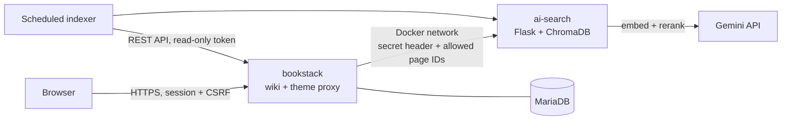

# Permission-Aware Semantic Search for a School Wiki

A semantic search add-on for a self-hosted BookStack wiki, built during my co-op at a K–12 school in Vancouver. Students, parents and staff ask questions in plain language and get the right page, filtered to what they are already allowed to see.

> This is a case study. The source code belongs to the school and stays private. Code walkthrough available on request.

**Stack:** Python · Flask · Gunicorn · ChromaDB · Gemini (embeddings + rerank) · BeautifulSoup · PHP (BookStack theme) · Docker Compose · Nginx · MariaDB

---

## The problem

BookStack is the school's source of truth for admissions, policy, learning support and event information. Its built-in search matches exact keywords only. The school planned to open the wiki to students and parents, who ask questions in natural language and use different words from the documents.

| A parent types | Keyword search | What they needed |
|---|---|---|
| "overseas study" | Only pages containing those exact words | International programme pages that never use the phrase |
| "special education needs" | Misses pages that don't use that phrase | Learning-support and assessment pages |

Two constraints from day one:

- **Self-hosted.** The wiki, the search service and the vector store all run on the school's server. Only the Gemini calls leave the network, and they can be swapped for a local model.
- **Non-invasive.** No fork of BookStack. The add-on attaches through a theme and a small HTML snippet and reads content through the REST API.

## My role

I designed and built the whole add-on on my own: the indexer, the search API, the BookStack theme proxy, the widget, the evaluation framework, the Docker deployment and the security review. It went through four versions (v1 → v1.5 → v2 → v3), each one driven by what the previous version measured badly. It is live in production for the wiki's 1,000+ daily users.

---

## Architecture

The containers are trust boundaries. The browser can only reach `bookstack`. The search service has no public port and no DNS name; BookStack reaches it over the internal Docker network.

### One search request

1. The widget POSTs the question to a same-origin route on the BookStack domain, with the session cookie and CSRF token.
2. The theme verifies the session and token, then computes the user's visible pages, books and shelves with BookStack's own permission system (`Page::visible()`), fresh on every request.
3. The theme forwards the question and the allowed IDs to the search service with a shared secret.
4. The search service embeds the query (cached for repeated questions) and retrieves the 10 nearest chunks from ChromaDB.
5. Gemini 2.5 Flash-Lite reranks those candidates. Its reply is parsed as numbers only.
6. Results are filtered to the allowed IDs and the top 5 pages come back as links with snippets. **No AI-generated answer is ever shown.**

### Indexing

Incremental: each run pulls pages through the BookStack API, checks each page's `updated_at`, and re-embeds only what changed, removing chunks for deleted pages. A scheduler runs it daily. A full rebuild costs about $0.07.

---

## Key design decisions

| Decision | Chosen | Rejected, and why |
|---|---|---|
| Where permissions are checked | BookStack, on every request | Filtering in the search service: it cannot see sessions, so it would have to trust the client |
| Output | Ranked links and snippets | Generated answers: a confident wrong answer is the worst failure for a policy wiki |
| Final ranking | Vector retrieval + LLM rerank (`/rag`) | My earlier hybrid endpoint (vector + BM25 fused with Reciprocal Rank Fusion): it scored lower MRR in eval, so I retired it |
| Why rerank at all | One extra small-model call per search | Vector distance and keyword overlap could not separate near-duplicate handbook pages |
| Model size | Small, fast model for rerank | A flagship model: the job is "which of these 10", which needs no reasoning or writing |
| Integration | Theme + HTML snippet | Patching BookStack source: a fork to maintain on every upgrade |

**The model's output type is the security boundary.** The rerank model reads document text, so anyone who can edit a page could try a prompt injection. Because the reply is parsed as a list of numbers and anything else is discarded, a fully successful injection can at most reorder results the user could already see. A failed or hijacked rerank falls back to the vector order.

**When quality is uncertain, degrade. When permission is uncertain, stop.** A rerank timeout degrades to vector order. A missing secret or a missing allowed-page list is refused (fail-closed), and a smoke test asserts that refusal before every deploy.

---

## Retrieval engineering

- **Structure-aware chunking.** Pages are split along headings, paragraphs, tables and lists with BeautifulSoup, with overlap, instead of fixed byte windows. Tables keep their rows and lists keep their bullets.
- **Context prefixing.** Each chunk carries its section heading and its Shelf / Book / Chapter path, embedded with the text.
- **LLM rerank.** The 10 nearest chunks go to a small model that reads the question and each passage together, which separates near-duplicate pages that vector distance cannot.
- **Relevance floor.** Weak matches are suppressed, so the system returns nothing rather than confident noise.
- **Cost controls.** Query-embedding cache, batched embedding calls, and automatic rotation across API keys on rate-limit errors.

---

## Evaluation

Every tuning change was accepted or rejected on a labelled test set: real questions, each with the page ID that should come back. `evaluate_retrieval.py` scores Precision@K, Recall@K and MRR against the running service.

| Test set | Recall@5 | MRR |
|---|---|---|
| 17 questions, first full run (2026-03) | 0.82 | 0.65 |
| 79 questions on real content (2026-07) | 0.91 | 0.74 |

- **Recall@5** asks whether the right page is in the top 5 at all. **MRR** asks how high it ranked: 1.0 means always first.
- Precision@5 sits around 0.2–0.26, which is expected: most questions have exactly one correct page, so the ceiling is close to 0.20.
- The eval also justified deleting work. The hybrid vector + BM25 endpoint I had built first scored lower MRR than the reranked path, so it was retired.

## Security

Written up as a self-review against the questions a technical director would ask:

- **Fail-closed permission filter.** A request with no allowed-page list gets HTTP 400 instead of the whole index. The filter is applied twice (in the ChromaDB query and on every returned result) and asserted in a smoke test.
- **No public port** on the search service; only the BookStack domain is exposed.
- **CSRF token** required on every search, so a foreign page cannot fire searches as a logged-in user.
- **Shared secret** compared in constant time, denied when unset, and rotated automatically by a host-cron script.
- **Per-user rate limiting** (5 requests / 5 s), real client IP resolved behind the reverse proxy.
- **Read-only, scoped indexing token**, so a compromised search service can read indexed content and nothing more.
- Snippets HTML-escaped, CSP nonce on the widget, error details hidden in production.

## Results

| | |
|---|---|
| Retrieval | Right page in the top 5 for 91% of 79 labelled questions (MRR 0.74) |
| Users | Live for the wiki's 1,000+ daily users |
| Cost | ~$0.0002 per search, about $2–3 per 10,000 searches |
| Full reindex | ~$0.07 |
| Added latency from rerank | 0.5–2 s |
| Public ports on the search backend | 0 |

## What I learned

- Measure before arguing. A labelled test set turned design debates (chunk size, hybrid vs rerank, whether rerank earns its latency) into numbers, and gave me a reason to delete my own work.
- Narrowing what the model is allowed to output solved hallucination, prompt injection and vendor lock-in with one decision.
- Keep permission decisions in the system that already owns them. A ranking bug in my code cannot become a permissions bug.
- Plan the handover. Credentials sit on a durable service account rather than my co-op account, and a 16-check deploy script verifies the stack before go-live.
